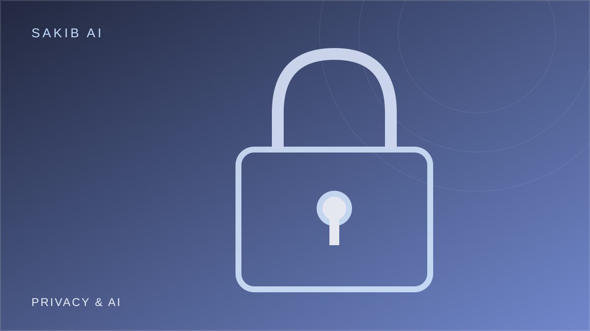

---
image:
  filename: "featured.svg"
title: "Can We Benefit From AI Without Sacrificing Privacy?"
date: 2026-10-12
draft: false
summary: "The tension between useful personalization and control over personal data."
tags: ["Artificial Intelligence", "AI Privacy"]
---

## Why AI systems want data

Data can make AI services more useful. A personalized assistant may remember your preferences. A medical model may identify patterns in health records. A fraud-detection system may learn from transaction behavior.

But the same information can reveal sensitive details about individuals. When data is collected, stored, combined, or shared, privacy risks increase. Even information that seems harmless in isolation can become revealing when linked with other records.

## Consent is not always enough

Privacy policies are often long and difficult to understand. People may agree to data collection without fully appreciating how their information could be used later. In workplaces or essential services, refusing consent may not be realistic.

That is why privacy cannot rely only on a checkbox. Organizations should collect only what they need, limit retention, restrict access, and explain how data is used.

## Technical approaches

Several methods can reduce privacy risks. On-device processing can keep some information on a person's device. Federated learning can allow models to learn from distributed data without centrally collecting every raw record, although it does not eliminate privacy risks by itself.

Differential privacy can provide mathematical protections in certain statistical settings. Encryption and access controls help protect stored and transmitted information. Each approach has limitations and must be matched to the actual threat.

## The surveillance concern

AI can make large-scale monitoring easier by analyzing images, speech, location data, and behavior. Such capabilities can support legitimate security applications, but they can also enable intrusive tracking and discriminatory enforcement.

The question is not only whether the technology works. It is who controls it, what oversight exists, and whether affected people can challenge misuse.

## My perspective

I believe privacy should be treated as a **design requirement, not an optional feature added after deployment**.

People should be able to benefit from useful AI without surrendering unnecessary personal information. Organizations that cannot clearly explain why they need a dataset should reconsider collecting it. Trustworthy AI requires technical protections, transparent policies, and meaningful accountability.

**Question for readers:** Would you use a more personalized AI assistant if it required storing much more of your personal information?
