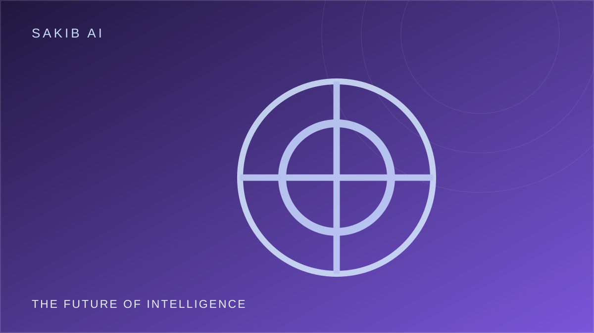

---
image:
  filename: "featured.svg"
title: "Will AI Become More Intelligent Than Humans?"
date: 2025-11-18
draft: false
summary: "What superintelligence means—and why predictions require humility."
tags: ["Artificial Intelligence", "Future of AI"]
---

## First, what does “more intelligent” mean?

AI already outperforms people at some narrow tasks. Computers can process enormous amounts of data, search complex spaces, and recognize patterns at scales that would be impossible for an individual. But intelligence is not one simple number.

Human intelligence includes learning, reasoning, creativity, social understanding, physical interaction, and the ability to pursue goals in changing environments. A system can excel at one benchmark while failing at a task a child finds easy. That makes broad comparisons difficult.

Researchers sometimes use the term *artificial general intelligence* (AGI) for systems with broad capabilities across many domains. There is no universally accepted test or definition of AGI, and experts disagree about how close current systems are.

## Capability is not the same as understanding

A model that writes excellent code may still make elementary errors when the requirements change. A model that produces a persuasive explanation may not have verified the facts behind it. Strong performance is real and valuable, but it should not be confused with unlimited competence.

Future AI systems may become more capable through better training, tools, memory, reasoning methods, and interaction with the world. Whether those advances lead to intelligence beyond humans across most domains remains uncertain.

## Why the question matters now

Even without superintelligence, powerful AI can reshape research, employment, cybersecurity, and public information. We do not need to settle the AGI debate before thinking seriously about oversight.

If systems become more autonomous, the key questions will include: Can humans understand what they are doing? Can their actions be constrained? Who is accountable when they cause harm? Can independent researchers evaluate their capabilities and risks?

## My perspective

I believe we should be curious about advanced AI without treating bold timelines as established facts. Claims that AGI is inevitable next year—or impossible forever—often go beyond what current evidence can demonstrate.

The more useful approach is to prepare for a range of futures. Invest in research and education, build evaluation methods, and create safeguards that scale with capability. **We should neither underestimate AI's potential nor surrender critical judgment to predictions about it.**

**Question for readers:** What would convince you that an AI system has genuinely general intelligence?
